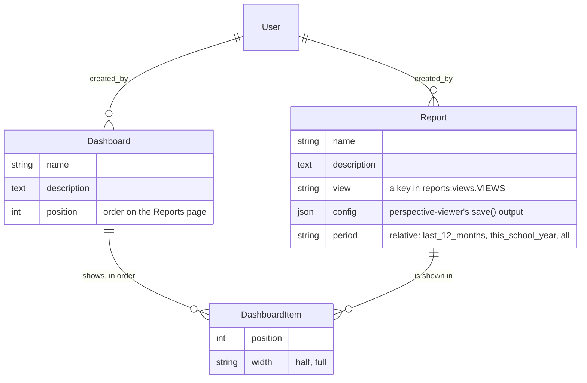

# Reporting dashboards for the organisation (§30, phase 1 built)

> Split out of `DATA_MODEL.md` (§30 there is the short version). Research
> and plan of 11 October 2026; phase 1 built the same day (see "Built so
> far" for where it differs from the design below).

## Built so far (11 October 2026)

Phase 1, plus the saving of phase 2: the `reports` app, one dataset, saved
reports, and the *Reports* area (*Insights* in the sidebar). Dashboards
(several reports on one page) aren't built yet. Where the build differs from
the design below:

- **The dataset is the segment builder's table:** *Children and how they
  come*, from the nightly engagement snapshot (`events.NinjaEngagement`, the
  overall row per child): stage, main dojo, its province, age band, gender,
  signed up for a session; children, sessions attended and offered (180
  days), sessions attended (all time), no-shows (90 days). Registrations,
  Ninjas, Dojos and the rest follow.
- **`reports/datasets/`, not `reports/views/`**, so the registry doesn't
  clash with the app's Django views. "Dataset" is also the word on the pages.
- **Small groups are generalised, not only left out** (`reports.datasets.base.generalise`):
  a row with fewer than `REPORT_MIN_GROUP` children gets its most identifying
  dimension replaced by "Other (small groups)", in a fixed order per dataset
  (main dojo, signed up, age band, gender, province, stage), and is merged
  with the rows that then match; only what's still too small after the last
  dimension is left out, and the page says how many children that was. With
  the 83 children of the dev data most rows end up under "Other"; real
  numbers keep more detail.
- **The saved settings don't depend on the language** (`reports/config.py`):
  Perspective names columns by the label it shows, so a report is stored with
  `col:<key>` and `val:<key>` (a translated value in a filter) and turned back
  into the viewer's language when it's opened; a column the dataset lost is
  dropped with a notice. `theme`, `title`, `table` and `settings` are never
  stored: the site decides them.
- **`Report` has no `period` yet** (the snapshot has no dates to filter on),
  and has `updated_by` next to `created_by`.
- **The policy needs `blob:` in `script-src` too**, not only `worker-src`:
  the bundles import their WebAssembly glue from a `blob:` URL, and the chart
  renderer's worker imports it again (blocked inside a worker, it fails
  silently: an empty chart). Still only on the report pages.
- **Perspective has no Dutch:** `reports/static/reports/perspective-nl.css`
  is ours (its labels are CSS variables), French is the package's.
- **View-only** (the `view_report` permission without the others) opens a
  report with the settings panel closed and no save form; nothing locks the
  panel, but nothing it does can be saved.
- **Caching:** the figures per dataset and language, for an hour, keyed on
  the column labels too (a deploy that changes a label gets new figures at
  once); `report.js`'s URL carries a hash of its contents, since static files
  are cached for days.
- **Accessibility:** the page around the viewer passes axe in both themes
  (`check_a11y.py` scans `/manage/reports/` and a new report). Inside the
  viewer, axe finds five things in Perspective's own shadow DOM that we can't
  fix from here: its column search box has no label, its rollup select no
  name and a target under 24px, an empty header cell in the data grid, and a
  `<ul>` holding a `
`. `check_a11y.py` leaves `<perspective-viewer>` out
  of the scan for that reason. Still to do (phase 2): the plain table of a
  report's numbers on the page; until then the CSV download is the
  alternative, and these findings are worth reporting upstream.
- **The board doesn't see Reports yet:** the open point below. One line
  (`"reports.report": _VIEW` in `BOARD_PERMISSIONS`) opens it read-only.

The organisation's administrators want to build their own reports and
dashboards: how many children came to a session this year, per province,
per pathway, how many girls, how many dojos are active, how volunteering
grows. Today the site has no charts at all; the only numbers are a
campaign's and a journey's delivery counts (`campaigns.services.stats`,
`campaigns.journeys.stats`) and the nightly engagement snapshot
(`NinjaEngagement`), which only segments use.

**The approach: curated views plus an embedded builder, the SAP Embedded
Analytics model.** Developers define *reporting views*, a fixed set of
columns each, checked against the privacy registry. Administrators build
reports and dashboards on those views in the browser with
[Perspective](https://perspective-dev.github.io/), an open-source pivot
table and chart component embedded in the organisation dashboard. We write
the views and the storage, not a builder.

| SAP Embedded Analytics | Here |
|---|---|
| CDS views, released for analytics | **Reporting views** in code (`reports/views/`): a fixed set of columns each, checked against the privacy registry, small groups of children already hidden on the server |
| Key users build analytical queries on them (*Custom Analytical Queries*) | **Administrators build reports** on a view in `<perspective-viewer>`: group by, split by, filter, aggregates, table or chart |
| KPI tiles and analytical apps in the launchpad | **Saved reports and dashboards** on `/manage/reports/`, in the organisation dashboard's shell, behind its login and access areas |

## Decided

- **The organisation's administrators (the `admin` role) create their own
  reports and dashboards** (11 October 2026). Any admin can edit any
  dashboard: they're the organisation's, not one person's, and the audit
  log shows who changed what.
- **No home-made builder** (11 October 2026): the builder is an existing
  component; we provide the views. See "Options considered".

## What it is, and what it isn't

- **The views are the boundary.** Whatever a view returns reaches the
  administrator's browser, and Perspective can regroup it any way, so a
  view only ever holds what anyone with access may see: aggregated rows
  (counts and sums by category), never a person, a name, an address, an
  email address or free text.
- **Only fields the privacy registry allows.** A view's columns are
  declared with their source field. A field classified `special` (health),
  `criminal` (background checks) or `security` can never be one, and a
  test checks every view against `core/privacy_registry.py`. The register
  of processing activities gets a "statistics" purpose for it.
- **Small groups are hidden on the server.** In a view about children, a
  row whose count is below `REPORT_MIN_GROUP` (proposed: 5) is merged
  into an "other" row or left out before the data leaves the server, so
  "girls aged 7 at dojo X in March" can't point to one child. Regrouping
  in the browser can't bring a hidden row back. Its cost: totals built
  from rows that had hidden groups come out a little low, and the page
  says so under every report on such a view.
- **New views are a developer's change**, like a new segment attribute
  today. Administrators choose among the views they're given.

## Options considered

| Option | Why not (or not now) |
|---|---|
| **A home-made report builder** (this plan's first version: datasets, measures and groupings as Django forms, charts drawn by us) | Reinvents what Perspective already does, with less to offer (no instant pivoting, no drag and drop) |
| [django-sql-explorer](https://django-sql-explorer.readthedocs.io/en/latest/features.html) (5.3.1, 24 Sept 2026, MIT) | Saved SQL queries: for people who write SQL. It sees every table, so health notes and background-check columns are one `SELECT` away, around the privacy registry and the audit log. Classifiers stop at Django 5.0 (we run 6.1). No dashboards |
| django-report-builder | A builder over Django models, but its last release is from 2021 and the repository has been quiet since 2023 |
| django-slick-reporting, django-controlcenter, django-dashboards | Every report or dashboard is written in Python: not something administrators can build |
| Metabase, Apache Superset (Preset), Grafana | Real no-code builders, but each is a separate server (Metabase 1–2 GB of memory) that Level27 can't run: a second host or a managed cloud, a new processor with a data processing agreement, its own logins and access rules. Their curation (Metabase *models*, Superset *datasets*) would sit on top of the same reporting views. Worth reconsidering only if the organisation gets a data team |
| Notebooks (marimo, Jupyter) | On the server, a notebook cell is arbitrary Python next to every secret and all the data, and Level27 can't sandbox it. In the browser (Pyodide), it's safe but it's code, not something administrators build. A later option for a technical volunteer, on the same view endpoints |

## Perspective

- **What it is:** `@perspective-dev/viewer` (5.5.1, 17 September 2026,
  Apache-2.0, an OpenJS Foundation project; the older `@finos/perspective-*`
  packages are deprecated in its favour). A `<perspective-viewer>` element
  with a data grid and charts (`@perspective-dev/viewer-datagrid`,
  `@perspective-dev/viewer-charts`): drag columns into group by, split by,
  filter and sort, choose aggregates, switch between table and chart
  types.
- **It runs in the browser** (WebAssembly). The server answers one query
  per view, so it runs on Level27 as it is: no extra server, no second
  database, and Celery has nothing to do.
- **Saving:** `viewer.save()` returns the report's whole setup (columns,
  grouping, filters, chart type, styling) as JSON, and `viewer.restore()`
  puts it back. A `Report` row stores that JSON with the view it's on. A
  dashboard is several saved reports in a layout (ours, in the page's grid;
  Perspective's own `restoreWorkspace` is the alternative to look at during
  phase 2).
- **Vendored, never from a CDN**, like htmx: under
  `core/static/core/vendor/perspective-<version>/` with a README (the npm
  packages, checked against the registry's checksums, and how to upgrade),
  guarded by the vendored-assets test. Loaded only on the reports pages:
  it's a few MB, and no other page needs it.
- **Content-Security-Policy:** WebAssembly needs `'wasm-unsafe-eval'` in
  `script-src`, and Perspective runs its engine in a web worker
  (`worker-src 'self'`). Both only on the reports pages, through a
  per-view policy override, never site-wide. `core.tests.SecurityHeadersTests`
  checks both: the reports pages have them, every other page doesn't.
  To check while vendoring: whether it needs `blob:` workers or inline
  styles (inline styles are already allowed).
- **Wiring:** a small `CoderDojo.initReport` in `bundle.js` (or a module
  next to the vendored files) creates the viewer, loads the view's data
  from its endpoint, restores the saved JSON, and on *Save* posts the new
  JSON back with the CSRF token. That's the one place this feature needs
  hand-written JavaScript: instant pivoting is local state in the browser,
  which htmx can't do.
- **Theme:** Perspective ships light and dark themes and is styled with CSS
  variables. Ours map the design tokens onto them and follow the site's
  theme switch.
- **Accessibility:** check the viewer with axe (`check_a11y.py`) in both
  themes during phase 1. Whatever it can't meet, the page makes up for:
  every saved report also has a plain `<table>` of its numbers (rendered
  on the server from the same view and setup for the common cases, or as
  a CSV download), so no figure is only in a chart.

## Data model (`reports` app, in the `pages`/`api`/`campaigns`/`privacy` layer: it reads across the domain)

- **Views are code** (`reports/views/`, one module each, registered like
  `SEGMENT_ATTRIBUTES`). Each declares its columns (a label, translated;
  the ORM path; the source field for the privacy check), its date column
  for the period, whether it's about children (then small groups are
  hidden), and builds one `values(...).annotate(...)` query. A first set:
  - **Registrations:** one row per session month, dojo, province/region
    (`geo`), dojo session or organisation event, pathway, age band, gender,
    attended and waiting list, with the number of places.
  - **Ninjas:** from the nightly snapshot (`NinjaEngagement`) where it can:
    home dojo, province, age band, gender, current belt, engagement stage,
    member since (year), with the number of children.
  - **Dojos:** status, province, languages, sessions per month.
  - **Volunteers:** memberships by role and status, applications by
    outcome per month. Never background-check details: only "has a valid
    check", yes or no.
  - **Accounts and mail:** sign-ups per month, login method, two-step
    login in use; mail sent and bounced per category per month.
- **A saved report survives a changed view.** The config is validated
  against the view's columns when it's saved and when it's opened. A
  column that's gone is dropped with a notice ("This report used *X*,
  which isn't available any more"), never a broken page.
- **Privacy and audit:** `Report` and `Dashboard` hold no personal data
  apart from `created_by` (`register(...)` with that one field). The audit
  log records them. No per-view logging: no personal data is shown.

## Endpoints, pages and access

- **A new area, `Area.REPORTS`**, with `accounts.view_reports` (open
  dashboards and reports) and `accounts.manage_reports` (create and edit
  them) in `AREA_PERMISSIONS` and `ROLE_PERMISSIONS`: the `admin` role both
  (decided), the `board` role viewing (proposed; it would be the board's
  first area). Every view calls `require_area`.
- `GET /manage/reports/data/<view>/?period=…`: the view's rows as JSON
  (or Apache Arrow, which Perspective loads fastest; check the size gain
  during phase 1), for `view_reports`. Cached through `core/caching.py`
  per view and period for an hour (`REPORT_CACHE_SECONDS`), with "as of
  HH:MM" on the page. Small groups are already hidden in what's cached.
- `/manage/reports/`: the dashboards, in order, and the saved reports.
- `/manage/reports/<id>/`: a report, read-only for `view_reports` (the
  viewer with its settings panel closed and locked), editable with
  *Save* and *Save as new* for `manage_reports`.
- `/manage/reports/dashboards/<id>/`: a dashboard, each report in its own
  viewer. Each loads its data on its own, so a slow one doesn't hold up
  the page.
- **CSV download** of a report's numbers, as shown.

## Performance

- One aggregate query per view and period, cached for an hour, so a
  dashboard of six reports on two views costs at most two queries an hour.
  The children views read the nightly snapshot where they can.
- The rows are already aggregated, so a view returns hundreds or a few
  thousand rows, not one per registration. Perspective handles millions;
  the limit here is privacy, not speed.
- `MEMORY_PROFILE.md` gets the data endpoint after phase 1, measured on a
  `seed_scale` database.

## Phases

1. **One view and one report** (built, with the engagement dataset): the `reports` app with the view registry
   and the privacy check, the Registrations view and its endpoint, small
   groups hidden, Perspective vendored with the page-only policy, the
   area and its permissions, and one report page where an administrator
   pivots and saves. This settles the open technical questions:
   accessibility, the security policy, theme, JSON or Arrow.
2. **Reports and dashboards:** `Report`, `Dashboard` and `DashboardItem`,
   the list and dashboard pages, view-only mode for the board, CSV, the
   Ninjas and Dojos views, and a starter "Organisation overview" dashboard
   seeded for the dev data.
3. **More views:** Volunteers, and Accounts and mail; comparing with the
   same period last year. Optionally a monthly mail of a dashboard's
   figures to the board, with charts drawn on the server with matplotlib
   (Perspective needs a browser, a mail doesn't have one).
4. **Dojo teams:** the same views filtered to one dojo, in the dojo admin
   area (`dojos.access`, a capability for §28's custom roles).

Each phase brings its tests, the help-centre pages in en/nl/fr
(`docs/source/organisation/`), translations (the view and column labels;
Perspective's own interface texts, as far as it supports languages, is a
phase 1 check), accessibility checks, the organisation journey PDFs, and
`MAINTENANCE.md` rows for the vendored component.

## Open points

- **Does the board view the dashboards** (proposed), and should it also
  build?
- **The threshold for small groups:** 5, or something else? A question for
  whoever advises the organisation on privacy. Only for views about
  children, or for all of them?
- **The first views:** which figures does the organisation (and its
  sponsors' reports) need most? That decides phase 1's view and phase 2's.
- **Perspective's languages:** if its interface can't be shown in Dutch
  and French, is English acceptable for the builder's own buttons? The
  column and view names are ours, and translated.
