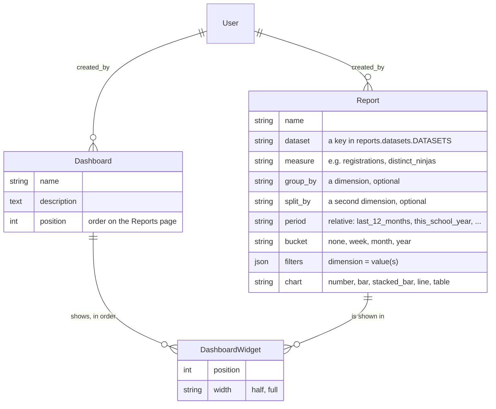

# Reporting dashboards for the organisation (§30, not built — plan)

> Split out of `DATA_MODEL.md` (§30 there is the short version). Research
> and plan of 11 October 2026, for review before anything is built.

The organisation wants to build its own reporting dashboards: how many
children came to a session this year, per province, per pathway, how many
girls, how many dojos are active, how volunteering grows. Today the site
has no charts at all; the only numbers are a campaign's and a journey's
delivery counts (`campaigns.services.stats`, `campaigns.journeys.stats`)
and the nightly engagement snapshot (`NinjaEngagement`), which is only
used by segments.

**Recommendation:** build a small report builder inside the organisation
dashboard on top of a code registry of curated *datasets*, the same
pattern as the segment builder's attributes (`campaigns/segmentation/`).
People pick a dataset, a measure, a grouping and a period. The result is
shown as a chart with a table, and they put saved reports on dashboards.
Not raw SQL, not notebooks, not an external BI server: why not is under
"Options considered".

## What it is, and what it isn't

- **Aggregates only.** Every report is counts or sums grouped by
  categories (dojo, province, month, pathway, age band, gender, belt,
  engagement stage, ...). It never lists a person, and never shows a
  name, an address, an email address or free text.
- **Only fields the privacy registry allows.** A dataset's dimensions and
  measures are declared in code. A field classified `special` (health),
  `criminal` (background checks) or `security` can never be one, and a
  test checks that against `core/privacy_registry.py`. The register of
  processing activities gets a "statistics" purpose for it.
- **Small numbers are hidden.** In a dataset about children, a group
  smaller than `REPORT_MIN_GROUP` (proposed: 5) is shown as "fewer than
  5". That's so a report like "girls aged 7 at dojo X in March" can't
  point to one child. The table, the chart and the CSV all apply it.
- **Built by the organisation, without code.** Admins compose reports and
  dashboards on `/manage/reports/`. A new *dataset* (a new kind of data)
  is a developer's change, like a new segment attribute today.
- **Server-driven, no JavaScript of its own.** Forms and a live preview
  over htmx, like the segment builder. The charts are SVG drawn on the
  server with matplotlib (see "Charts").

## Options considered

| Option | What it is | Fit here |
|---|---|---|
| **Curated report builder in Django (recommended)** | Our own models plus a registry of datasets. Aggregates through the ORM, charts in the dashboard shell | Runs on Level27 as it is, follows the privacy registry and the area permissions, matches how segments already work. Costs: we build and maintain it, and it's less flexible than SQL |
| [django-sql-explorer](https://django-sql-explorer.readthedocs.io/en/latest/features.html) (5.3.1, 24 Sept 2026, MIT) | Saved SQL queries in the browser, parameters, simple matplotlib charts, CSV, query log, optional AI assistant | Built for people who write SQL, not for the organisation's admins. It sees every table, so health notes and background-check columns are one `SELECT` away: that bypasses the privacy registry and the audit log's masking. It needs a read-only database user (`max_user_connections` is 32 on Level27). Its classifiers stop at Django 5.0, and we run 6.1. The AI assistant sends the schema and sample rows to an outside LLM. At most a superuser's tool, and not on production with children's data |
| Embedded notebooks: [marimo](https://docs.marimo.io/guides/wasm.html) (0.25, Apache-2.0), Jupyter | A notebook as a page. marimo can export to a static WebAssembly page that runs in the browser | Notebooks are code, the opposite of "the organisation builds them". A WASM notebook has no database access, so it would need an API serving the aggregates (which is the recommended option's work anyway). Not every package runs in WASM. A live Jupyter or marimo server can't run on Level27's Python hosting (no extra services, and the Celery component has about 512 MB) |
| Metabase / Apache Superset | Full BI servers with dashboard builders and embedding | Can't run on Level27: Metabase is a JVM application (1–2 GB of memory in the hosting templates found), Superset needs its own Python, Redis and Celery. That means a second server, and children's personal data copied into another system (a processor, an entry in the register, its own access control and retention). In the open-source Metabase, embedding is a read-only iframe; signed embeds with per-user filters are paid. Worth it only if the organisation gets a data team |
| Grafana (already in the devcontainer's `monitoring` profile) | Dashboards over Prometheus or a SQL data source | The same hosting problem as Metabase. It's a tool for engineers, and it would need direct SQL access to the personal data. It stays the tool for the site's own metrics (`MONITORING.md`) |
| django-controlcenter, django-dashboards and similar packages | Dashboard widgets defined in Python code | Every dashboard is code, so the organisation can't build its own. django-controlcenter is tested up to Django 4, and its author asks for pull requests instead of maintaining it |

So nothing standard in Django gives non-technical people their own
dashboards over data this sensitive. The packages either hand out raw
SQL or need a developer per dashboard. The segment builder already shows
how to do it in a way that fits this site.

## Data model (`reports` app, a new app in the `pages`/`campaigns` layer: it reads across the domain)

- **Datasets are code** (`reports/datasets/`, one module each, registered
  like `SEGMENT_ATTRIBUTES`). Each has a base queryset, its dimensions
  (a label, the ORM path, how the values are labelled and translated),
  its measures (`Count`, `Count(distinct=True)`, `Sum`), the date field
  periods apply to, and whether it's about children (then small numbers
  are hidden). A first set:
  - **Registrations**: one row per place. Dimensions: session month,
    dojo, province/region (`geo`), organisation event or dojo session,
    pathway, child's age band and gender, attended, waiting list.
  - **Ninjas**: from the nightly snapshot (`NinjaEngagement`) where it
    can, so it stays cheap. Dimensions: home dojo, province, age band,
    gender, current belt, engagement stage, member since (year).
  - **Dojos**: status, province, languages, sessions per month.
  - **Volunteers**: memberships by role and status, applications by
    outcome per month. Never background-check details: only "has a valid
    check", yes or no.
  - **Accounts and mail**: sign-ups per month, login method, two-step
    login in use; mail sent and bounced per category per month.
- **Reports and dashboards are rows**, edited on the dashboard. Every
  field of a definition is validated against the registry, the way
  `SegmentAttribute.validate` does it, so a stored report that no longer
  fits (a removed dimension, say) shows a readable error instead of
  breaking the page.
- **Privacy and audit:** `Report` and `Dashboard` hold no personal data
  apart from `created_by` (`register(...)` with that one field). The
  audit log records them, so it's visible who changed what. No per-view
  logging: no personal data is shown.

## Pages and access

- **A new area, `Area.REPORTS`**, with permission
  `accounts.view_reports` for viewing and `accounts.manage_reports` for
  building (`AREA_PERMISSIONS`, `ROLE_PERMISSIONS`). **Decided (11 October
  2026): the organisation's administrators (the `admin` role) create their
  own reports and dashboards.** Any admin can edit any dashboard: they're
  the organisation's, not one person's, and the audit log shows who
  changed what. Proposed: the `board` role views them. That would be the
  board's first dashboard area, since overseeing the numbers is what it's
  for.
- `/manage/reports/`: the dashboards, in order. A dashboard's page shows
  its widgets, each loaded on its own (`hx-trigger="load"`), so a slow
  one doesn't hold up the page.
- `/manage/reports/new/` and `/manage/reports/<id>/`: the report editor,
  with the dataset, measure and dimensions as selects that update each
  other over htmx (as segment rules do) and a live preview.
- **Every chart has its table** (a `<table>` under it, or in a
  `
` for a large one): the accessible alternative (WCAG 1.1.1),
  what works without JavaScript, and what prints. There's a CSV download
  of the same aggregated numbers.
- **Charts: see "Charts" below** (matplotlib on the server, as SVG).

## Charts: matplotlib on the server

matplotlib is already in the repo (`requirements-dev.txt`;
`quality/charts.py` and `loadtest/charts.py` draw the quality and
capacity charts with it). It moves to `requirements.txt`, so production
installs it too (with numpy; Pillow is already there).

- **What it draws:** `reports/charts.py` turns a report's aggregated
  numbers into an SVG. The page inlines it (no extra request; the
  Content-Security-Policy allows inline SVG), and a `<title>`/`<desc>`
  carries a one-line summary for screen readers. The table under it
  stays the full accessible alternative.
- **Why matplotlib rather than a JavaScript library:**
  - It follows the site's rule (htmx and server rendering, hand-written
    JS only when nothing else can do it).
  - Nothing new to vendor or keep up to date in the browser.
  - The same SVG works in a monthly mail to the board (phase 3), in print
    and in a PDF, where a JavaScript chart can't.
  - The team already knows it from the quality and capacity charts.
- **What it costs:**
  - **Install size:** numpy and matplotlib add tens of MB to the server's
    environment.
  - **Memory:** matplotlib is imported inside the render function, never
    at module level, so a web worker pays for it only once it draws a
    chart. Its memory per worker is measured in `MEMORY_PROFILE.md` before
    phase 1 ships, against the Level27 budget (`CAPACITY.md`). If it's too
    much, the drawing moves to the Celery default queue and the page polls
    for it over htmx.
  - **Speed:** a chart takes tens to a couple of hundred milliseconds to
    draw. The SVG is cached together with the numbers (below), so it's
    drawn once per hour per report and theme, not per view.
  - **Interactivity:** no hover tooltips. The table gives the exact
    figures.
- **Theme and colours:** the design tokens' colours are set in a
  matplotlib style (`reports/charts.py`). A chart is drawn once for the
  light theme and once for the dark one, cached separately. The `Agg`
  backend is set explicitly, since there's no display on the server.
- **The other choice** is a JavaScript library such as Chart.js
  (vendored, wired from `bundle.js`). It's interactive, but needs
  JavaScript, can't go in a mail, and is one more browser dependency.

Adding matplotlib and numpy to production means rows in `MAINTENANCE.md`
and a `pip-audit` run, in the same change.

## Performance

- One aggregate query per widget: `values(*dimensions).annotate(measure)`
  with the period filter, never rows into Python. The children datasets
  read the nightly snapshot where they can.
- Each result (the numbers and its two SVGs) is cached through
  `core/caching.py`, keyed by a hash of the report's definition, for an
  hour (`REPORT_CACHE_SECONDS`), and cleared when the report is saved. That fits the rule "cache the data, never the
  page". The figures say "as of HH:MM".
- `MEMORY_PROFILE.md` gets the report pages after phase 1, measured on a
  `seed_scale` database, as for every page that reads many rows.

## Phases

1. **Engine and a fixed dashboard:** the registry with the Registrations,
   Ninjas and Dojos datasets, small-number hiding, the area and its
   permissions, matplotlib charts (with their memory measured), and one built-in "Organisation overview"
   dashboard (children per month, per province, new ninjas, active
   dojos). The board and the admins get value before there's an editor.
2. **The builder:** `Report`, `Dashboard` and `DashboardWidget`, the
   editor with its live preview, composing dashboards, CSV.
3. **More data:** the Volunteers and Accounts-and-mail datasets, and
   comparing with the same period last year. Optionally a monthly mail
   of a dashboard to the board, through the mail engine.
4. **Dojo teams:** the same engine, scoped to one dojo, in the dojo admin
   area (`dojos.access`, a capability for §28's custom roles).

Each phase brings its tests, the help-centre pages in en/nl/fr
(`docs/source/organisation/`), translations, accessibility checks, and
the organisation journey PDFs.

## Open points

- ~~Who builds~~ Decided: the administrators create their own reports and
  dashboards. Still open: does the board view them (proposed), and should
  the board also build?
- **The threshold for small numbers:** 5, or something else? A question
  for whoever advises the organisation on privacy. Should it apply to
  every dataset, or only those about children?
- **The first dashboard:** which figures does the organisation (and its
  sponsors' reports) need most? That decides the datasets of phase 1.
- **matplotlib's memory on Level27:** if the measurement says it's too
  much in the web workers, draw in the Celery worker instead (see
  "Charts").
- **A raw-SQL tool for a technical volunteer:** if one is wanted later,
  it would be django-sql-explorer against a read-only database user that
  sees only views without personal columns, for superusers only. Not part
  of this plan.
