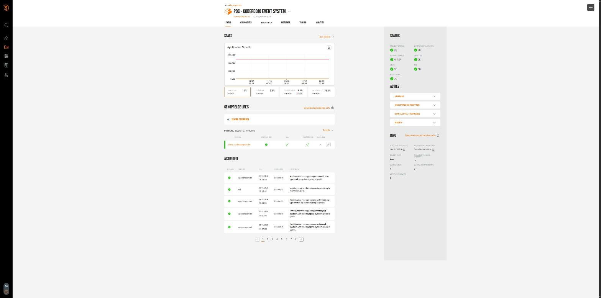
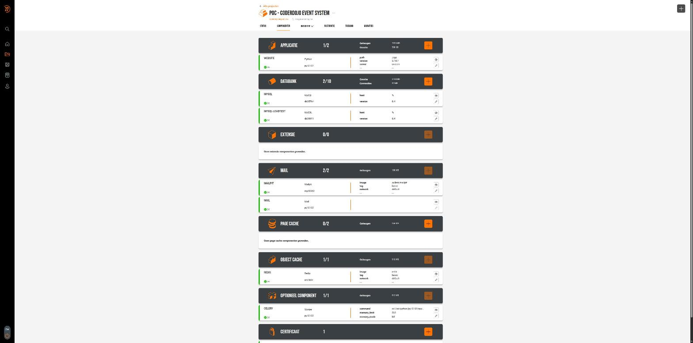
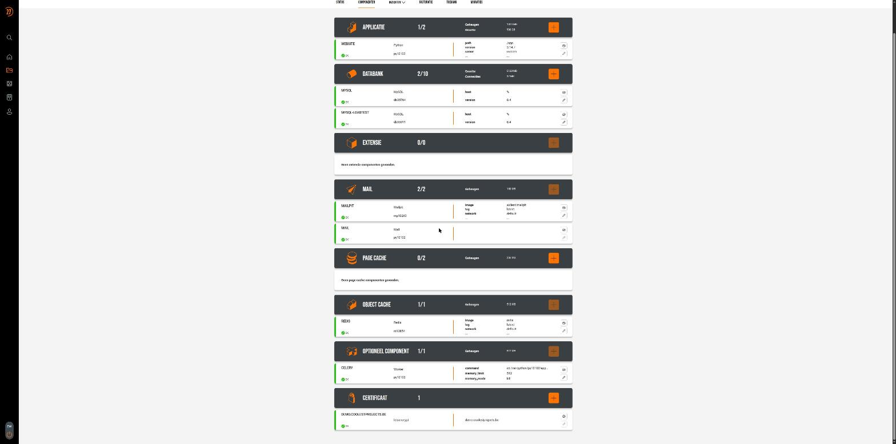
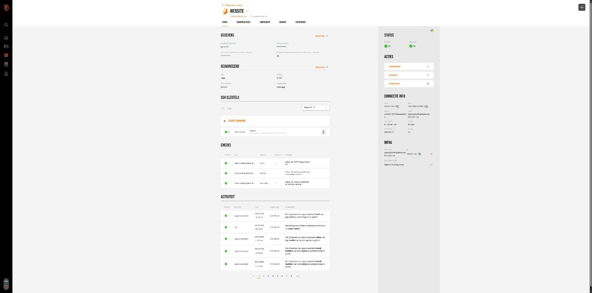

# Level27 deployment: provisioning, components and procedures

How production is provisioned on Level27, what each component does, how a deploy actually runs end to
end, and how load is tested safely against the live site. For developers and whoever runs the platform.
Versions and their support windows are in [`MAINTENANCE.md`](MAINTENANCE.md); open questions for Level27
are in [`LEVEL27_QUESTIONS.md`](LEVEL27_QUESTIONS.md); measured capacity and load figures are in
[`CAPACITY.md`](CAPACITY.md); the day-to-day deploy commands are in
[`scripts/CLAUDE.md`'s "Deploying (Level27)" section](scripts/CLAUDE.md#deploying-level27). This page is
a snapshot of the Level27 panel on **11 October 2026**; the panel is the source of truth, this page a
guided tour of it.

A rendered PDF of this page, with the screenshots below in full size, is
[`user-journeys/level27-deployment.pdf`](user-journeys/level27-deployment.pdf) (built the same way as the
other PDFs under `user-journeys/`, see its [`README.md`](user-journeys/README.md)).

---

## Contents

1. [What's provisioned](#whats-provisioned)
2. [The components, one by one](#the-components-one-by-one)
3. [Networking, TLS and the domain](#networking-tls-and-the-domain)
4. [The deploy procedure](#the-deploy-procedure)
5. [The two Celery workers on Level27](#the-two-celery-workers-on-level27)
6. [Load testing in production](#load-testing-in-production)
7. [Known constraints and gotchas](#known-constraints-and-gotchas)
8. [Where to look next](#where-to-look-next)

---

## What's provisioned

Production runs as one Level27 **project** ("POC - Coderdojo Event System", project id `22212`,
`https://app.level27.be/projects/projects/22212/`), package type **Run** (Level27's Python hosting), with
**7 components** in total, reached only through Level27's own reverse proxy for one linked URL,
`demo.coolestprojects.be` (the SSL certificate's own name is `demo.coolestprojects.be`, kept from an
earlier working name for this instance). There is no root access to the underlying server: everything
below is managed either through the Level27 panel/API, or over SSH as the unprivileged account user
`py10102`.



At a glance, the panel's own status page shows project status, component status, running status, limits,
URL and SSL all **OK**, with monitoring also OK. The linked URL table shows `demo.coolestprojects.be` with
health, SSL and **forced SSL** all green and **caching off** (an intentional choice — see
["Architectural choices visible in the panel"](#architectural-choices-visible-in-the-panel) below).

### The 7 components

| Group | Component | Type/image | Level27 id | Purpose |
|---|---|---|---|---|
| Applicatie | `website` | Python 3.14.7, uvicorn ASGI server, command `main:app` | `py10102` | The Django app itself |
| Databank | `mysql` | MySQL 8.4 | `db03764` | Production database |
| Databank | `mysql-loadtest` | MySQL 8.4 | `db05411` | Disposable database for production load tests (see [§6](#load-testing-in-production)) |
| Mail | `mailpit` | `axllent/mailpit:latest` | `mp10263` | Mailpit, kept running beside real mail — used only while a load test or a demo switch points the app's outbound mail here |
| Mail | `mail` | Level27's own outbound mail relay | `py10102` | The real SMTP path (`EMAIL_HOST=localhost`) production mail actually goes out through |
| Object cache | `redis` | `redis:latest` | `rd12854` | Cache (db 0), Channels layer (db 1) and Celery broker (db 2) — all three share this one Redis |
| Optioneel component | `celery` | "Worker" type, two commands | `py10102` | Both Celery workers (`periodic` and `mailing`), see [§5](#the-two-celery-workers-on-level27) |

(Extensie and Page cache groups are present but empty — 0 components each — matching the design in
`CLAUDE.md`, "Caching": the site caches *data* in Redis, never whole pages, so there is deliberately no
Level27 page-cache component.)





### Architectural choices visible in the panel

A few things the panel confirms that aren't obvious from the code alone:

- **The database runs on its own dedicated host**, `agencyhosting-lesse-mysql8.level27.eu` (internal IP
  `172.21.155.6`), separate from the web app's host, `agencyhosting-lesse-web.level27.eu`
  (`194.32.155.7`). The app reaches it over the internal network at `db03764c.l27powered.eu:3306`.
- **The "Mail" application component and the "website" component share the same Level27 app id**
  (`py10102`): Level27's outbound relay is attached to the app, not a separate container — matching
  `EMAIL_HOST=localhost` in production's `.env` (`scripts/CLAUDE.md`).
- **Caching is off at the proxy** (the linked URL's "Caching" column is unchecked) — intentional:
  `CLAUDE.md`'s "Caching" section explains why a whole page is never cached (every page carries its own
  CSP nonce, CSRF token and per-account nav), only the data behind it, in the app's own Redis.
- **Forced SSL is on at the proxy** for `demo.coolestprojects.be`, independent of Django's own
  `SECURE_SSL_REDIRECT` (which is still `false` — `MAINTENANCE.md`'s security log, 8 Oct 2026 entry): the
  proxy itself already refuses plain HTTP for the linked URL, ahead of whatever Django's own setting
  decides.
- **A second, disposable MySQL database** (`mysql-loadtest`, `db05411`) sits provisioned and idle most of
  the time: it only gets used for a production load test ([§6](#load-testing-in-production)), never for
  anything else.

---

## The components, one by one

### `website` (the Django app)



- **Credentials panel**: username `py10102`, password masked (Level27-managed), no separate Basic-Auth
  password set.
- **Advanced panel**: path `/app`, Python version `3.14.7`, ASGI server `uvicorn`, command `main:app` —
  matching `scripts/CLAUDE.md`: `main.py` re-exports `website.asgi.application` as `app`, and
  gunicorn (the Level27 panel calls the setting "server: uvicorn") runs `gunicorn -k
  uvicorn.workers.UvicornWorker main:app`.
- **SSH keys**: one key registered (`ssh-ed25519`, used by `scripts/deploy.sh` for its SSH session to
  `py10102@c40a7b15f.l27powered.eu`).
- **Checks**: three monitored checks against `demo.coolestprojects.be` — HTTP (status 200), latency
  (response time under threshold) and SSL expiry — all green.
- **Connection info**: IPv4 `194.32.155.7`, IPv6 `2a02:5b41:4:440::4`, FQDN
  `c40a7b15f.l27powered.eu`, host `agencyhosting-lesse-web.level27.eu`, HTTP/HTTPS on 80/443, SSH/SFTP on
  22.
- **Activity log**: every panel change is attributed to the account holder and timestamped — on 8 October
  2026 this shows, in order, the `mysql-loadtest` component being created (twice — once for the database
  itself, once for its credentials), the `celery` worker component being updated (the command change
  recorded in `MAINTENANCE.md`'s security log, "App server switched from daphne back to gunicorn"), and
  the `demo.coolestprojects.be` URL's monitoring being turned on. This log is the authoritative record of
  who changed what in the panel and when — useful alongside `MAINTENANCE.md`'s security log and the
  application's own audit log (`core/audit.py`) when reconstructing an incident.

### `mysql` and `mysql-loadtest` (databases)

Both are MySQL 8.4, host wildcard (`%`, i.e. reachable from the app's network), on the same dedicated
database host. `mysql` (`db03764`) is the real production database; `mysql-loadtest` (`db05411`) is a
second, empty-most-of-the-time database that exists only so a load test can point the live app at
throwaway data without touching real families' bookings (`scripts/loadtest_demo.sh`, [§6](#load-testing-in-production)).
Each has its own credentials panel (masked password) and its own activity log, each entry attributed and
timestamped the same way as the website component's.

### `mailpit` and `mail` (outbound mail)

Two separate "Mail" components with two different jobs:

- `mail` (Level27's own relay, attached to app id `py10102`) is what real production mail goes out
  through, all the time.
- `mailpit` (`axllent/mailpit:latest`, its own small container, `mp10263`) catches mail only when the app
  is deliberately pointed at it — during a production load test, so a test never sends real mail to real
  families (`scripts/loadtest_demo.sh`'s `switch` step edits `~/app/.env`'s `EMAIL_HOST` etc. to point
  here, and `restore` points it back).

### `redis` (object cache)

One `redis:latest` component (`rd12854`) serves three logically separate Redis databases from the
application's point of view — `CACHES` (db 0), Django Channels (db 1) and the Celery broker (db 2) — all
on the one Level27-managed Redis instance (confirmed separately via SSH, `MAINTENANCE.md`: Redis 8.10.1,
`maxmemory` 512 MB, policy `allkeys-lru`, not yet the `volatile-lru` the caching design assumes — tracked
in `LEVEL27_QUESTIONS.md` #1).

### `celery` (the optional "Worker" component)

One "Optioneel component" of type **Worker**, memory limit **512 MiB**, memory mode **kill** (confirmed in
the panel 8 Oct 2026, after an earlier *throttle* setting caused a 19-minute mail stall under load —
`LEVEL27_QUESTIONS.md`, "Memory limit of the Celery component"), running **two separate commands** — the
`periodic` worker (with beat embedded) and the `mailing` worker. Full detail in
[§5](#the-two-celery-workers-on-level27).

### Certificate

One certificate, `demo.coolestprojects.be`, issued via **Let's Encrypt** (auto-renewing), bound to the
`website` application. It is what the "SSL" and "Forceer SSL" checks on the project's linked-URL table
confirm are green.

---

## Networking, TLS and the domain

- The **public entry point** is `demo.coolestprojects.be`, which resolves to the web app's IPv4
  `194.32.155.7` / IPv6 `2a02:5b41:4:440::4` and is served, TLS included, by Level27's own reverse proxy —
  not by anything in this repository. Apache in front of the app (not nginx; nginx is only the
  devcontainer's own development proxy, `.devcontainer/nginx/`) serves `/static/` and `/media/` directly
  from disk under the account's home directory via an "Extra Apache configuratie" block configured in the
  panel, and proxies everything else to the app's Unix socket, `/var/run/socket/py10102.socket`.
- **SSH** is the only other path in: `py10102@c40a7b15f.l27powered.eu`, port 22, key-based only (one
  `ssh-ed25519` key registered on the `website` component, used by `scripts/deploy.sh`). There is no root
  access; nothing below the account's own home directory is reachable.
- **The database host is separate from the web host** on Level27's internal network
  (`agencyhosting-lesse-mysql8.level27.eu`, `172.21.155.6`) — the app reaches it by its own internal FQDN,
  never a public address.
- **Forced SSL is on** for the linked URL; Django's own `SECURE_SSL_REDIRECT` is still off pending
  confirmation that Level27's proxy always sets `X-Forwarded-Proto` (`LEVEL27_QUESTIONS.md` #7,
  `MAINTENANCE.md`'s security log) — the proxy's own forced-SSL setting is a separate, already-active
  safety net ahead of that.
- **The proxy's maximum request body size** is still unconfirmed with Level27 (should match the
  devcontainer's 12 MB `client_max_body_size` — `LEVEL27_QUESTIONS.md` #2), as is **how the proxy connects
  to the app's socket** (new connection per request, or a kept-open pool — `LEVEL27_QUESTIONS.md` #3),
  which matters for sizing `gunicorn.conf.py`'s per-worker concurrency cap correctly.

---

## The deploy procedure

Production is deployed with **one script**, `scripts/deploy.sh` (`scripts/deploy.sh --check` for a
read-only preflight that changes nothing). Both talk to the server only over the same SSH connection
(`py10102@c40a7b15f.l27powered.eu`) the `website` component's registered key authorises. What a real
deploy does, in order:

1. **Bundles the working tree**, excluding development-only paths (`user-journeys/`, `loadtest/` and
   similar tooling never ships).
2. **Installs `requirements.txt`** into the exact pyenv environment gunicorn runs from on the server
   (`~/.pyenv/versions/py10102-3.14.7`) — deliberately *not* a separate `~/app/.venv`, so there is only
   ever one environment to keep in sync with what's actually running.
3. **Runs `manage.py check` on the new code before touching the live app.** This is the main safety gate:
   a broken migration or a missing setting fails here, before anything is rsynced into the live
   `~/app`.
4. **Rsyncs the new code into `~/app`**, keeping `.env`, `media/`, `private_media/` and `staticfiles/`
   untouched (those aren't part of the release).
5. **Migrates** the database.
6. **Runs `collectstatic`** into `~/app/staticfiles` (`STATIC_ROOT`, set only in production), which Apache
   serves at `/static/` through the "Extra Apache configuratie" block in the panel — `media/` the same way
   at `/media/`.
7. **Puts the new code live**: a graceful `HUP` to the running gunicorn master (reloads workers on the new
   code with no dropped connections) when gunicorn is the configured server, or a stop/start via systemd
   when the panel is set to daphne (daphne can't reload in place, so that path means roughly 30 seconds of
   downtime while `Restart=always` brings it back — `deploy.sh` detects which one is actually running and
   handles either).
8. **Smoke-tests over the Unix socket** directly (bypassing the proxy, so this step alone can't be fooled
   by a cached response).
9. **Restarts both Celery workers with a warm shutdown**: `SIGTERM` to each worker's main process, which
   lets whatever task it's mid-way through finish before Level27's worker component notices the process
   stopped and starts it again — now on the new code — and the script pings both workers afterwards to
   confirm they came back. Level27 runs the workers, not the deploy script directly (there is no systemd
   access to create units of our own on this account), so this is the extent of control available: warm
   shutdown plus Level27's own "restart automatically" behaviour on the worker component.
10. `chmod o+x "$HOME"` is run on every deploy — a concrete gotcha this guards against: switching the
    app server in the Level27 panel (gunicorn ↔ daphne) makes Level27 reapply its managed Apache
    configuration, which resets the account's home directory to `750`. That strips the `o+x` bit Apache
    needs merely to traverse into `~/app/staticfiles` and `~/app/media` to serve them — regardless of the
    `Require all granted` in the Apache config block, since that's an authorization check, not a
    filesystem permission check. This caused a real outage on 8 October 2026 (every visitor got a 403 on
    every static/media/doc asset for at least 7 minutes) when a panel-only server-type change reset the
    permission outside of any code deploy, so the fix in `deploy.sh` didn't run. **The gotcha isn't fully
    closed**: a panel change that isn't a code deploy (e.g. only flipping the server type) still needs
    `chmod o+x ~` run by hand afterwards — `MAINTENANCE.md`'s security log, 8 Oct 2026 entry, documents
    this as a known, accepted gap rather than something coded around.

`scripts/deploy.sh --check` runs the read-only parts of this (connectivity, which app server is actually
live, whether `gunicorn.conf.py`'s concurrency cap is really being read, both workers' ping status, the
account's home-directory permissions, `SECURE_SSL_REDIRECT`/HSTS settings) without deploying anything —
the way to verify production's actual state before deciding whether a deploy is needed.

**Production env vars** live only on the server, in `~/app/.env` — never in this repository. To replace
them, a local `.env.production` (gitignored) placed next to the script gets uploaded on the next deploy.

---

## The two Celery workers on Level27

Both workers run as **one Level27 "Optioneel component"** (type Worker, `celery`), which is the mechanism
that gives us two long-running background processes without systemd access: each worker is one line in the
component's *Commando's* list, and Level27 restarts a command's process whenever it stops (crash or
deploy-time warm shutdown alike). Confirmed directly in the panel (8 Oct 2026) — the two commands, in full:

**`periodic` (beat embedded, queue `periodic`):**

```sh
cd /var/python/py10102/app && nice -n 10 celery -A website worker -n periodic@%h -Q periodic -c 1 -B \
  --scheduler django_celery_beat.schedulers:DatabaseScheduler \
  --max-tasks-per-child 100 --max-memory-per-child 160000 -l WARNING
```

**`mailing` (default queue `celery`):**

```sh
cd /var/python/py10102/app && nice -n 10 celery -A website worker -n mailing@%h -Q celery -c 1 \
  --max-tasks-per-child 100 --max-memory-per-child 160000 -l INFO
```

Both match `scripts/CLAUDE.md`'s documented worker design (one queue each, concurrency 1, beat only on the
`periodic` worker so there is exactly one beat scheduler) with three production-only hardening flags not
present in the devcontainer's version of these commands:

- **`nice -n 10`** — lower CPU scheduling priority, since both workers share the same machine as gunicorn
  and Apache.
- **`--max-tasks-per-child 100`** and **`--max-memory-per-child 160000`** (156 MiB) — each worker process
  is recycled after 100 tasks or once its child exceeds about 156 MB, a defence against slow memory growth
  over a long-running process, on top of the whole component's 512 MiB kill limit.
- **`periodic` logs at `WARNING`, `mailing` at `INFO`** — matching `MAINTENANCE.md`'s note that the
  periodic worker's 10-second dispatcher would flood the log at `INFO` (development keeps `INFO` on both
  since its logs are far smaller and more useful to read while developing).

**Memory.** The whole component has a hard ceiling of about 512 MiB (Level27 package limit, not
adjustable from the dashboard — `LEVEL27_QUESTIONS.md`), set to **kill** rather than *throttle*: when a
process in the component would exceed the limit it's killed outright and Level27 restarts it within
seconds, rather than every process in the component slowing down together (measured: throttle caused a
19-minute mail stall under a stress test on 8 October 2026; after switching to kill, a forced over-limit
run was killed after 19 seconds and the mailing worker was back within 10 — `LEVEL27_QUESTIONS.md`,
`CAPACITY.md`).

---

## Load testing in production

Two very different things both fall under "load testing" here, with very different risk:

### Read-only checks — always safe

- `manage.py capacity_report` over SSH — database size and its growth projection.
- `/metrics/` with `METRICS_TOKEN` as a bearer token — the site's own live counters (queue depth, request
  timings, process memory).
- `scripts/deploy.sh --check` — whether the gunicorn concurrency cap is actually in effect.
- **A `public`-mode load test** (`loadtest/run.sh ... public`) — visitors only, no login, nothing written
  to the database. Safe to run directly against the real production site.

### A load test that logs in and books — needs the database switch below

`loadtest/locustfile.py`'s `mixed` and `rush` modes log in as seeded accounts and book real sessions, so
run against the real production domain they would create fake bookings and send real mail to real
families. The script refuses to run against any host that isn't local unless
`LOADTEST_CONFIRM_REMOTE_HOST` explicitly names that exact host — a one-time, deliberate opt-in, never a
default.

**On a demo/showcase deployment that genuinely has no real users yet** (this current instance — confirmed
with whoever owns the decision each time this is used, never assumed), `scripts/loadtest_demo.sh` and
`scripts/run_demo.sh` automate the only safe way to run these modes against the live domain: repoint the
*real, running* app at the disposable `mysql-loadtest` database for the test window, run the test, then
put the real database back. This is exactly what the `mysql-loadtest` component and the `mailpit`
component sitting in the panel are provisioned for.

**`scripts/loadtest_demo.sh switch`** — over SSH, on the server, never touching the local machine:

1. Checks that `~/<mail env file>` (default `loadtest-mail-mailpit.env`, holding the Mailpit component's
   `EMAIL_HOST` etc.) exists on the server — **refuses to proceed without it**, since a test database has
   made-up email addresses and switching mail too is what stops a test from spamming invented addresses or,
   worse, addresses that happen to be real.
2. Backs up `~/app/.env` to `~/app/.env.backup-before-loadtest` — **refuses to overwrite an existing
   backup**, so `restore` always has exactly one real `.env` to go back to, never a stale second backup
   silently replacing it.
3. Edits only the `DB_HOST`/`DB_PORT`/`DB_NAME`/`DB_USER`/`DB_PASSWORD` lines in `~/app/.env` in place to
   point at `mysql-loadtest`'s credentials, and the mail settings to Mailpit's — every other setting
   (`SECRET_KEY`, Redis, everything else) is left untouched.
4. Reloads the live gunicorn with the same graceful `HUP` a code deploy uses, and warm-restarts both Celery
   workers (`SIGTERM`, wait up to 60s, then confirm both answer a Celery `inspect ping`) — so nothing is
   left reading the old database or sending through the old mail path.
5. **Clears the Redis cache (db 0 only)** — the broker and Channels databases are left alone. This matters
   because the cache still holds the *other* database's content (the dojo finder, a dojo's public page);
   skipping this step is exactly what caused the real site to briefly show test data after a `restore` on
   8 October 2026, until the cache was cleared by hand.
6. **Verifies, not just assumes**: reads `/metrics/` over the Unix socket directly (bypassing the proxy)
   and checks the reported table row counts actually match the throwaway database, before declaring the
   switch done.

**`scripts/run_demo.sh NAME USERS RATE DURATION [MODE]`** then runs `loadtest/run.sh` against the live
domain (`https://demo.coolestprojects.be` by default) with `LOADTEST_CONFIRM_REMOTE_HOST` set
automatically to match — the one place that confirmation is set non-interactively, and only because
`loadtest_demo.sh switch` has already made it safe to do so.

**`scripts/loadtest_demo.sh restore`** reverses all of it: copies the `.env` backup back, reloads
gunicorn, restarts both workers, clears the cache again, verifies via `/metrics/`, and removes the backup
file — so a stale backup left lying around can never be mistaken later for "still switched."

**`scripts/loadtest_demo.sh status`** reports which database and which mail server `~/app/.env` currently
points at, and whether a backup file is present (i.e. whether the site currently looks switched) — the
first thing to check before trusting what the live site is showing, and the last thing to check after a
test to confirm `restore` actually completed.

### A public load test against production, step by step

From a developer's own machine (never the server itself — the load generator shouldn't compete with the
site for CPU):

1. Pick a quiet moment (a weekday evening, nothing else happening that day) and tell the board; check
   `/health/` first.
2. Make sure `METRICS_TOKEN` is set in production's `.env` (a long random string).
3. Start small and stop at the first sign of trouble: 50 users for 3 minutes, then 150 (about 30
   requests/second — several times the busiest real moment observed so far); don't go past 300 without
   agreeing it with Level27 first, since their proxy and other customers share the same machine.
4. Watch `/metrics/` while it runs (`run.sh` samples it automatically every 2 seconds); stop (Ctrl-C) if
   the 95th-percentile latency passes 2 seconds, errors pass 1%, or `/health/` goes to 503.
5. Compare the results against the devcontainer's own public-mode figures and keep the dated results file.

A production run goes through Level27's real proxy with real TLS, so it doubles as an end-to-end check of
the proxy's own limits and its connection behaviour towards gunicorn — not just the application's own
`gunicorn.conf.py` cap.

---

## Known constraints and gotchas

Things that only became visible once the app was actually run against Level27's real limits, not the
devcontainer's defaults (full detail and dates in `LEVEL27_QUESTIONS.md` and `MAINTENANCE.md`'s security
log):

- **MySQL's real connection limit is much tighter than the devcontainer's default.** The app's own DB user
  has `max_user_connections = 32` (confirmed from the panel's package configuration, "Connecties: 32" —
  fixed by the hosting package, not adjustable), against the devcontainer's default of 151. The
  concurrency cap in `gunicorn.conf.py` (each web worker's `UVICORN_LIMIT_CONCURRENCY`) was originally
  sized against the devcontainer's number and had to be lowered (25 → 8 per worker, 8 Oct 2026) once
  measured against the real limit — the old value produced real `500` errors under a rush, not just
  graceful `503` refusals.
- **The Celery component's 512 MiB memory limit is fixed by the package**, not adjustable from the
  dashboard; what *is* a choice is its behaviour at the limit (kill vs. throttle — set to kill, see
  [§5](#the-two-celery-workers-on-level27)).
- **Redis's eviction policy is `allkeys-lru`, not `volatile-lru`.** The caching design assumes only keys
  with a timeout (cache entries) are ever evicted under memory pressure, leaving the Celery broker's queued
  tasks and `/metrics/`'s untimed counters alone; under `allkeys-lru` those are evictable too. Usage is
  tiny today (a few MB of 512 MB), so this is headroom, not an active incident — tracked as an open ask to
  Level27 rather than something worked around in code.
<br/>
- **A Level27 panel change that isn't a code deploy can silently break static/media serving** — see step
  10 of [the deploy procedure](#the-deploy-procedure) (the `chmod o+x ~` gotcha). This is the single
  highest-impact gap documented here: it caused a real, if short, full-site outage once already, purely
  from a panel setting change with no code involved.
- **Several infrastructure questions are still open with Level27** and tracked (not duplicated here) in
  `LEVEL27_QUESTIONS.md`: the proxy's maximum request body size, whether the proxy keeps connections open
  towards gunicorn or opens a new one per request, whether MySQL/Redis are dedicated to this account or
  shared, who rotates the Celery workers' own log files, and who patches what (OS/MySQL/Redis assumed to be
  Level27's; Python and its packages assumed to be ours — not yet explicitly confirmed).

---

## Where to look next

| Question | Where |
|---|---|
| Exact deploy commands, day to day | [`scripts/CLAUDE.md`, "Deploying (Level27)"](scripts/CLAUDE.md#deploying-level27) |
| Versions running in production, their end-of-life dates, the security log | [`MAINTENANCE.md`](MAINTENANCE.md) |
| Open technical questions for Level27, and what they've already answered | [`LEVEL27_QUESTIONS.md`](LEVEL27_QUESTIONS.md) |
| Measured load, memory per component, database growth, how to measure again | [`CAPACITY.md`](CAPACITY.md) |
| Every Prometheus metric and Grafana panel explained | [`MONITORING.md`](MONITORING.md) |
| How a security incident or data breach is handled | [`MAINTENANCE.md`, "Responding to a vulnerability"](MAINTENANCE.md#responding-to-a-vulnerability) |
| How the two-Celery-worker design on Level27 was decided | [`DATA_MODEL_MAILING.md`, "Production: two Celery workers as a Level27 worker component"](DATA_MODEL_MAILING.md#production-two-celery-workers-as-a-level27-worker-component) |
